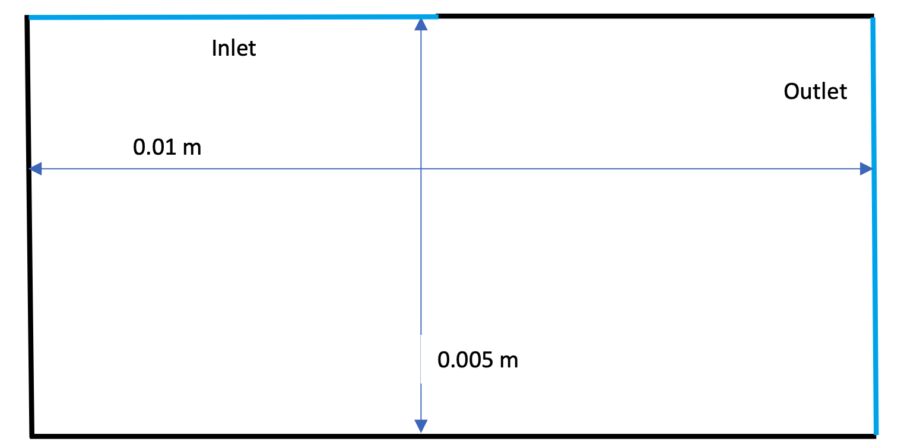
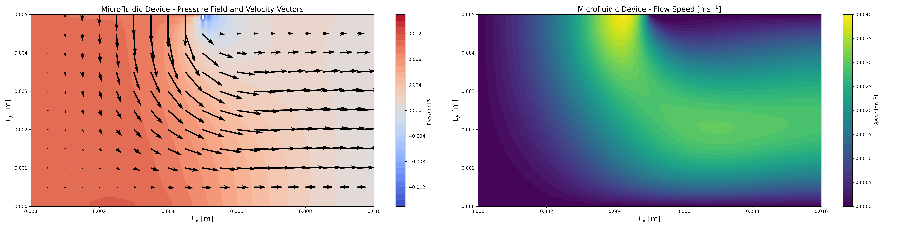

# VloeiStof

*Vloeistof* is Dutch for “fluid.”

VloeiStof is a Python package for simulating two-dimensional incompressible fluid flow. It is an ongoing numerical-modelling project focused on implementing and exploring finite-difference methods for the Navier–Stokes equations. It's designed to be a rapid prototyping tool to get a sense of the flowfields of things like microfluidic devices, tubes, or walled domains. 

## Overview

The solver numerically integrates the incompressible Navier–Stokes equations, coupling the momentum equations with a pressure Poisson equation to enforce mass conservation. Projecting it following the standard Chorin projection method. All grids are collocated, not staggered, so you'll likely get some artifacts when you run simulations. Don't worry, follow a staggered grid like Arakawa C-grid is on the list of stuff to do...

## Microfluidic Device
As an example showcase of the solver, lets investigate the flow through a microfluidic device following this design:



Device dimensions are 0.01 by 0.005 meters, where the inlet is on the ceiling and extends halway. The full right wall is an outlet. Using the standard fluid characteristics of water (density = 1000kg/m3 etc), and a pressure delta of 0.01 Pa. We can solve the steady flow to be:



If users are interested, output flags can be activated to save the flowfield through the integration, allow animations to be made. 

## Installation

Requires Python 3.11 or later.

```bash
git clone <repository-url>
cd VloeiStof
python -m pip install -e .
```

## Usage

For best usage, checkout the `showcase.ipynb` example jupyter notebook in `examples/` for the most detailed walk through. But the core usage is as follows:

Create grids of pressure and velocity, as well as a boundary mesh of the domain. And create the `NavierStokesSolver` object. Then solve the incompressible navier stokes equations with `solver.solve_NS(t_end=10)` to integrate to 10 seconds. There is a latent steady-state watch to exit out of integration if flow is steady. 

```python
solver = NavierStokesSolver(
    boundary_mesh=boundary_mesh,
    Pmax=Pmax,
    p=p,
    u=u,
    v=v,
    nu=nu,
    rho=rho,
    Lx=Lx,
    Ly=Ly,
    Nx=Nx,
    Ny=Ny,
)

solver.solve_NS(t_end=10)
```

## Testing

Run the test suite with:

```bash
pytest
```

Check code quality with Ruff:

```bash
ruff check .
ruff format --check .
```

## License

This project is released under the MIT License.

